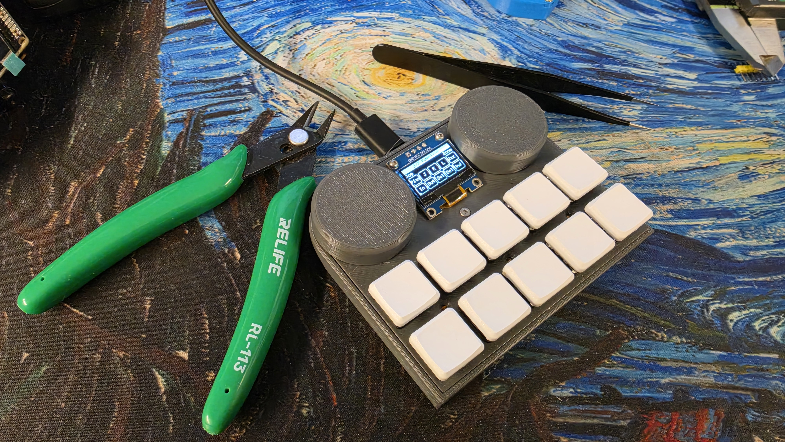
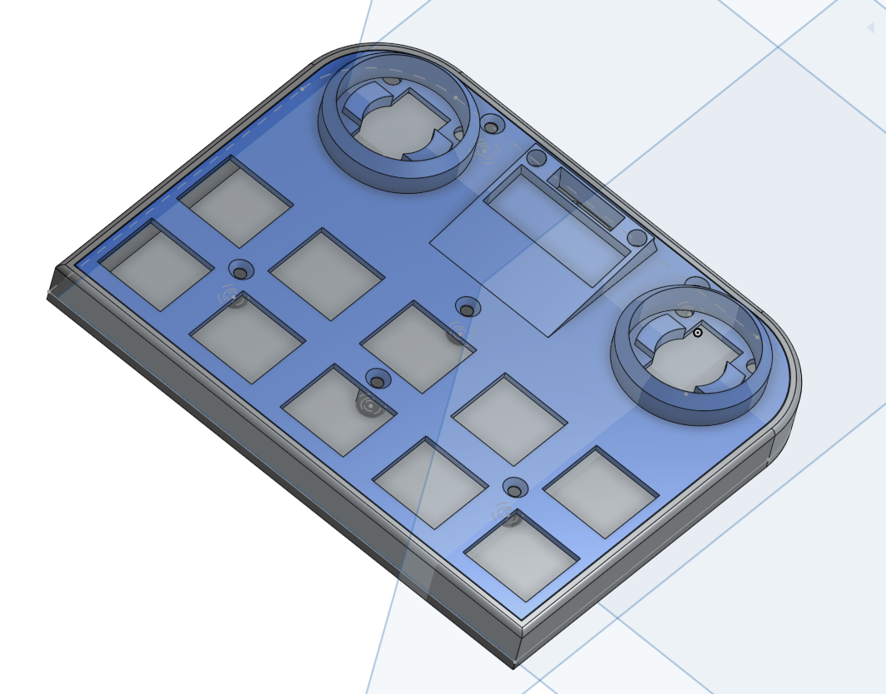
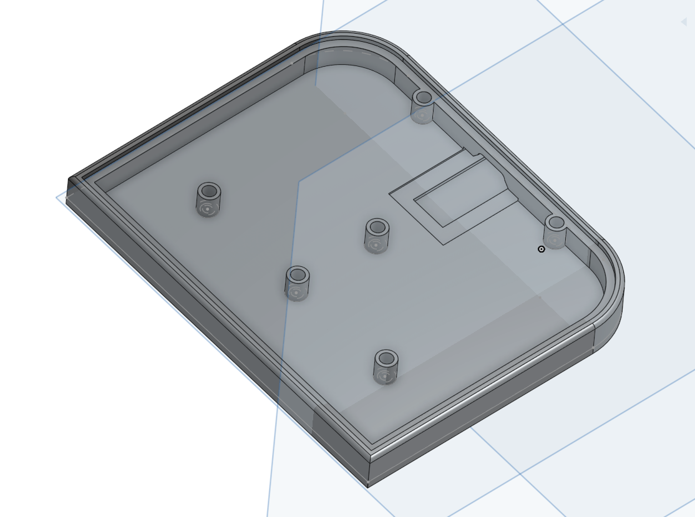
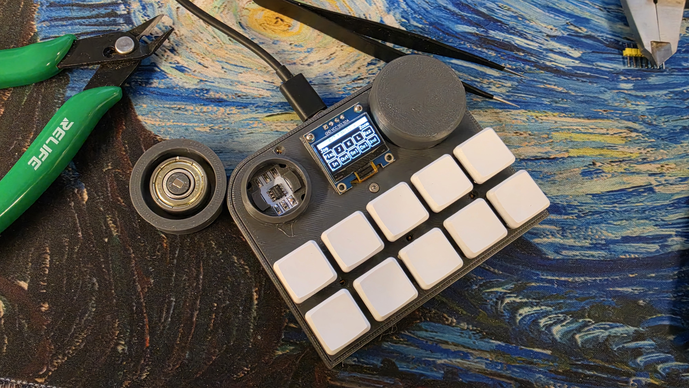
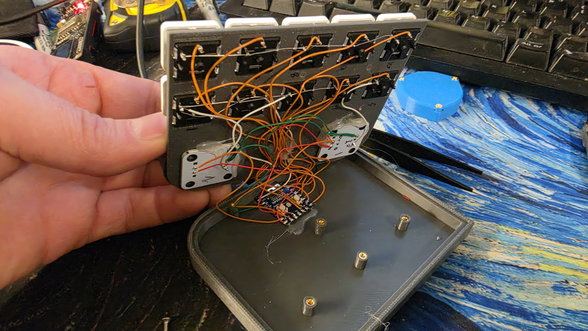

# Jogwheel Macropad



A USB macropad built on a Raspberry Pi Pico (RP2040). It has two magnetic jog wheels, a 128×64 OLED and 10 buttons, and switchable layers for video editing (Kdenlive, DaVinci Resolve), everyday desktop use, gaming and more.

```
   (L)   [  OLED  ]   (R)        L / R = AS5600 magnetic jog wheels
   [1]  [2]  [3]  [4]  [5]
   [6]  [7]  [8]  [9]  [10]
```

The Pico shows up as a normal USB keyboard and mouse, so no drivers or host software are needed. The USB serial port stays active as well, so you can flash new firmware without pressing BOOTSEL.

## Features

- **Up to 16 layers**, each with its own button and wheel mapping, stored in a `layers.json` file on the pad. No reflashing needed to change them
- **Two ways to edit the layers**: a **web configurator** (Chrome/Edge, over USB) with live wheel-speed tuning, or the pad opens as a **USB drive** and you edit the file in any text editor
- **Automatic layer switching**: a small script tells the pad which app is focused (Kdenlive → Kdenlive layer, and so on)
- **Speed-sensitive jog wheels**: turning slowly is precise (one frame per step), turning faster repeats steps, and spinning switches to a coarser action (for example 1 second per step)
- **Wheel modes**: key/media/scroll steps, held modifiers (Alt+Tab switcher), mouse X/Y movement
- **OLED UI** showing the current layer, the wheel functions (they light up while turning, with `x3` / `>>` for acceleration) and a live button map
- **Layer select** with Fn + wheel or Fn + button; the last used layer is remembered after power-off
- **Screensaver**: the OLED dims after 30 s and turns off after 5 min to prevent burn-in
- **Bootloader from the buttons**, for when the enclosure hides BOOTSEL
- **Watchdog + safe mode**: if the firmware ever hangs, it reboots and skips loading the config, so a bad file can't lock you out
- A separate **hardware test sketch** for checking wiring

## Hardware

| Part | Notes |
|---|---|
| Raspberry Pi Pico (RP2040) | |
| 2× AS5600 magnetic encoder module | One per I2C bus. Both have the fixed address `0x36`, so they can't share a bus |
| 2× 3.75 × 3.75 × 2.8 mm magnet | One per knob, see [Knobs and magnets](#knobs-and-magnets) |
| SSD1306 128×64 OLED (I2C, `0x3C`) | Shares I2C0 with the right wheel |
| 10× Kailh Choc v1 (low profile) switches + keycaps | Snap into the top plate; each connects its GPIO to GND when pressed (internal pull-ups) |
| 2× 608 skateboard bearings (8 × 22 × 7 mm) | One per knob; standard skateboard / fidget-spinner bearings |
| Screws + heat-set inserts | Hold the top plate to the base |

### 3D-printed case

The case was designed in Onshape:
**[Onshape document](https://cad.onshape.com/documents/e5c53d49cc4a243dfd63b13c/w/92bbd47e276381db8906be49/e/00501a3f613c48bb17cfad4c)**

[`3d/jog-macro.3mf`](3d/jog-macro.3mf) contains all the parts, ready to slice:

- **case**: the top plate with the switch cut-outs, the OLED window and the two knob wells with sensor pockets
- **base**: the bottom shell with the screw posts
- **knob**: print two, each holding a bearing and a magnet

Everything prints **without supports**.

| Top plate | Base |
|---|---|
|  |  |

### Knobs and magnets



Each knob turns on a standard **608 skateboard bearing (8 × 22 × 7 mm)** and carries a small **3.75 × 3.75 × 2.8 mm magnet** in its centre, directly above the AS5600.

The magnet is **push-fit sideways** into the knob. The AS5600 needs the field to rotate *in the plane of the chip*, so the magnet's north and south poles must sit side by side, parallel to the sensor, not one above the other. A normal block magnet is magnetised through its thickness, so inserting it on its side puts the poles in the right orientation without needing a diametric magnet.

Use the [hardware test sketch](#hardware-test-sketch) to check the alignment: it shows the magnet status on the OLED. Aim for `OK` (not `WEAK`/`STRONG`/`NO MAG`), and check the angle sweeps smoothly through a full 360° turn.

### Switches

The Choc v1 switches simply snap into the top plate. The buttons are wired directly to the Pico's GPIOs (no diode matrix), each with its other leg to GND. The AS5600 modules sit under the knob wells in the top plate.



### Wiring

| Function | Pico pin |
|---|---|
| I2C0 SDA (OLED + right wheel) | GP12 |
| I2C0 SCL (OLED + right wheel) | GP13 |
| I2C1 SDA (left wheel) | GP14 |
| I2C1 SCL (left wheel) | GP15 |
| Buttons 1–5 (top row, left → right) | GP1 – GP5 |
| Buttons 6–10 (bottom row, left → right) | GP6 – GP10 |
| Button other leg | GND |
| AS5600 / OLED VCC | 3V3 |

Pins and button order can be changed in [`src/config.h`](src/config.h).

## Software setup

The firmware uses [PlatformIO](https://platformio.org/) with the [Earle Philhower Arduino core](https://github.com/earlephilhower/arduino-pico). The core is fetched automatically through the `maxgerhardt/platform-raspberrypi` platform.

```bash
pip install platformio      # or install the PlatformIO IDE extension for VS Code
git clone https://github.com/hrafnkell/jogwheel-macropad.git
cd jogwheel-macropad
pio run                     # build
```

The first build downloads the toolchain and takes a few minutes.

### Flashing

**First time:** hold BOOTSEL while plugging in the Pico, then run:

```bash
pio run -t upload
```

Alternatively, copy `.pio/build/pico/firmware.uf2` onto the `RPI-RP2` drive.

**After that:** just run `pio run -t upload`. PlatformIO resets the Pico into its bootloader over USB serial.

> **Note:** `platformio.ini` sets `upload_port` / `monitor_port` to one specific Pico's serial path
> (`/dev/serial/by-id/usb-Raspberry_Pi_Pico_<serial>-if00`). Change it to match yours:
> `ls /dev/serial/by-id/`. This is needed because the HID firmware changes the USB product ID,
> so PlatformIO can no longer find the board on its own.

**If USB upload stops working** (for example after a bad firmware), use the button bootloader:

- Hold **button 1 + button 10** for 3 seconds while running, or
- Hold **button 1 + button 10** while plugging in the USB cable.

The `RPI-RP2` drive will appear. Run `pio run -t upload`, or copy the `.uf2` onto it.

Your `layers.json` lives in a separate flash area, so it survives firmware updates.

### Hardware test sketch

[`hwtest/main.cpp`](hwtest/main.cpp) scans both I2C buses and shows the wheel angles, magnet status (OK / WEAK / STRONG / NO MAG) and the button states on the OLED and over serial.

```bash
pio run -e hwtest -t upload   # flash the test sketch
pio device monitor            # watch the log (115200 baud)
pio run -t upload             # back to the macropad firmware
```

## Using it

### Layer switching

Button 1 (top-left) doubles as **Fn**:

| Action | Result |
|---|---|
| Tap button 1 | Its normal action for the current layer (fires on release) |
| Hold button 1 + turn left wheel | Cycle through layers |
| Hold button 1 + press button 2…8 | Jump directly to layer 1…7 |
| Hold button 1 + press button 9 | Open / close the config USB drive |
| Hold button 1 + button 10 for 3 s | Reboot into the USB bootloader |

While Fn is held, the OLED shows the layer picker.

### Default layers

These are the built-in defaults ([`config/default_layers.json`](config/default_layers.json)). Change them however you like, see [Customising](#customising).

| # | Layer | Left wheel | Right wheel | Buttons 1–5 | Buttons 6–10 |
|---|---|---|---|---|---|
| 1 | General | Scroll | Volume | Copy · Paste · Cut · Undo · Redo | Prev · Play/Pause · Next · Mute · Lock screen |
| 2 | Kdenlive | Jog (frames → 1 s) | Timeline zoom (Ctrl+scroll) | Play · J · K · L · Razor (Shift+R) | In · Out · Select clip (+) · Ripple delete (select + Shift+Del) · Undo |
| 3 | Resolve | Jog (frames → 1 s) | Timeline zoom (Alt+scroll) | Play · J · K · L · Split (Ctrl+B) | In · Out · Select clip (Shift+V) · Delete · Undo |
| 4 | Desktop | Window switcher (Alt+Tab) | Browser tabs (Ctrl+Tab) | Back · Forward · Reload · New tab · Close tab | Reopen tab · Find · Address bar · Fullscreen · Screenshot |
| 5 | Gaming | Mouse look (X) | Weapon switch (scroll) | Esc · 1 · 2 · 3 · 4 | Tab · Q · E · R · F |
| 6 | Draw | Mouse X | Mouse Y | Esc · Left click · Middle click · Right click · Undo | Draw lock (toggle left button) · Ctrl · Shift · Alt · Delete |
| 7 | Numbers | Up / Down | Left / Right | 1 · 2 · 3 · 4 · 5 | 6 · 7 · 8 · 9 · 0 |

**Video editing tips**

- The zoom wheels send Ctrl/Alt + mouse wheel, so the mouse pointer must be over the timeline.
- *Select clip* selects the clip under the playhead, so *Delete* removes it. In Kdenlive, *RDel* does both in one press: it selects the clip, then sends Shift+Delete.
- **Draw** is an etch-a-sketch mode. Open a paint program, press *Draw* to lock the left mouse button, then turn both wheels.

## Customising

The key map and all the wheel tuning live in **`layers.json`** on the pad's flash. On first boot the pad writes the built-in defaults there. There are several ways to change it, and none needs a rebuild.

### Desktop app (Linux and Windows)

[`desktop/`](desktop) is a native configurator built with [GPUI](https://gpui.rs). It has the same features as the web configurator and also handles automatic layer switching itself, so you don't need the Python script while it's open.

```bash
cd desktop
cargo install --path .     # installs ~/.cargo/bin/jogwheel
jogwheel                   # open the configurator
jogwheel --autoswitch -v   # no window: only switch layers to match the focused app
```

Building needs Rust (via [rustup](https://rustup.rs)).
- **Linux** also needs the X11/Wayland dev libraries. On Debian/Ubuntu:
  `sudo apt install libxkbcommon-dev libxkbcommon-x11-dev libwayland-dev libvulkan-dev libfontconfig-dev libfreetype-dev libx11-xcb-dev libxcb1-dev`
- **Windows** needs the Visual Studio C++ build tools (rustup offers to install them). `cargo install --path .` gives you `jogwheel.exe`. The pad is found by its USB ID on whichever COM port it gets.
- Every push that touches `desktop/` builds both versions with GitHub Actions; the `.exe` and the Linux binary can be downloaded from the run's **Artifacts**.

- It finds the pad automatically and reconnects after unplugging or a firmware upload. **Disconnect** releases the port
- **Auto-switch** tab:
  - turn switching on or off
  - see the focused window's class, title and which layer it matches
  - add apps you've recently used to the selected layer with one click
  - tick *start in the background at login* so `jogwheel --autoswitch` keeps switching layers after you close the window (Linux: `~/.config/autostart`; Windows: the `HKCU\…\Run` registry key)
- On Linux it opens the port without locking it, so `pio run -t upload` works while it's running. Windows always locks COM ports, so click **Disconnect** before uploading firmware or using the web configurator

On Windows the "class" sent to the pad is the program name followed by the window class, e.g. `kdenlive Qt5152QWindowIcon`, `Resolve …` or `firefox MozillaWindowClass`. Rules like `"apps": ["kdenlive"]` therefore work on both systems. The Auto-switch tab shows exactly what's being sent.

### Web configurator

**👉 [Open the configurator](https://hrafnkell.github.io/jogwheel-macropad/web/)** in **Chrome or Edge** (WebSerial isn't available in Firefox) and click **Connect pad**.

It's a single file, [`web/index.html`](web/index.html), so it also works offline: open it from disk, or serve the repo root with `python3 -m http.server` and go to `http://localhost:8000/web/`.

- Click a key, a wheel or the screen on the pad drawing to edit it
- **⏺ Rec** records a key combination; **Pick…** has media keys, mouse actions and common shortcuts
- **+ Add key** turns a button into a key sequence (for example *select clip* then *Shift+Delete*); **+ Wait** adds a pause between steps
- Add, duplicate, reorder and delete layers, and set which apps each one auto-switches for
- **Wheel tuning** tab: the acceleration curve as a graph. Turn a wheel on the pad and a dot shows its live speed on the curve, so you can see exactly where acceleration kicks in
- **Pad selects keys** mode: pressing a key or turning a wheel on the pad selects it in the editor (and the pad stops typing meanwhile)
- **Save to pad** stores `layers.json` and applies it immediately. **Download** / **Open file…** let you keep copies

### Edit the file on the USB drive

Hold **Fn (button 1) + button 9**. The pad appears as a small USB drive containing `layers.json`, a [`REFERENCE.txt`](config/REFERENCE.txt) with every key name and option, and an `errors.txt` if something didn't parse.

Edit and save `layers.json`, then press **Fn + button 9** again to close the drive. The pad reloads straight away.

> **Don't use Eject / Safely remove in the file manager.** On Linux (and Windows) that powers off
> the whole USB device, keyboard included, until you replug it, and unsaved flash metadata is lost.
> Always close the drive with Fn + button 9.

### The JSON format

```jsonc
{
  "name": "Kdenlive", "short": "Kden", "apps": ["kdenlive"],
  "left":  { "label": "Jog", "mode": "steps", "steps": 48, "ccw": "left", "cw": "right",
             "accel": 4, "fast_ccw": "shift+left", "fast_cw": "shift+right" },
  "right": { "label": "Zoom", "mode": "steps", "steps": 16, "ccw": "ctrl+scroll_down", "cw": "ctrl+scroll_up" },
  "buttons": [
    { "label": "Play", "action": "space" },
    { "label": "Razr", "action": "shift+r" },
    ...
  ]
}
```

- **Actions** are key names joined with `+`, modifiers first: `ctrl+shift+z`, `alt+tab`, `f5`, `kp_plus`, `vol_up`, `play_pause`, `mouse_left`, `latch_left` (drag lock), `scroll_down:3`, or just `ctrl` to hold a modifier
- **Key sequences** (buttons only): steps separated by commas, e.g. `"kp_plus, shift+delete"`. The steps are tapped in order and the last one is held while you hold the button. `wait:100` pauses 100 ms; up to 8 steps
- **Wheel modes**: `steps` (an action every 1/`steps` of a turn), `mouse_x` / `mouse_y` (`px` per turn), `none`. `hold` keeps modifiers down while turning (e.g. `"hold": "alt"` + `tab` = window switcher)
- `//` comments are allowed

[`config/REFERENCE.txt`](config/REFERENCE.txt) has the full list of key names and options.

> **Keyboard layouts:** keys are sent as US key *positions*. Letters, digits, arrows and F-keys work
> on most layouts, but symbols (`minus`, `equal`, brackets…) land elsewhere on non-US layouts.
> Prefer keypad keys (`kp_plus`) or scroll-based shortcuts for those.

### Tuning the jog wheels

Wheel speed is measured in **turns per second** and drives this curve:

| Setting | Default | Meaning |
|---|---|---|
| `accel_start` | 0.4 | Below this, every step is exactly one action (frame-accurate) |
| `accel_full` | 1.5 | At this speed, the wheel's full `accel` multiplier applies |
| `accel_curve` | 1.0 | Shape of the ramp in between: 1 = linear, 2 = gentle start, 0.5 = kicks in early |
| `fast_speed` | 1.8 | Above this, wheels with `fast_ccw` / `fast_cw` switch to those (e.g. jump 1 s instead of 1 frame) |
| `smoothing_ms` | 50 | Speed smoothing. Higher is steadier but slower to react |

These go in `"settings"` and apply to every wheel. Any wheel can override them with its own `accel_start`, `accel_full`, `accel_curve` and `fast_speed`. Per wheel, `accel` sets the max multiplier (steps are repeated up to that many times; mouse modes are sped up by it). The configurator's **Wheel tuning** tab shows all of this as a graph with live readings.

Other settings: `invert_left` / `invert_right`, `hold_release_ms`, `layer_steps`, `brightness`, `dim_after_s`, `sleep_after_s`, `auto_fallback`.

### Automatic layer switching

[`tools/jogwheel-autoswitch.py`](tools/jogwheel-autoswitch.py) watches which window has focus (X11, uses `xprop`) and sends its window class and title to the pad. The pad switches to the first layer whose `apps` list matches:

- `"apps": ["kdenlive"]` matches when the window class contains `kdenlive`
- `"title:youtube"` matches the window title instead
- If nothing matches, the pad switches to `settings.auto_fallback` (default `General`). Set it to `""` to stay on the current layer

```bash
tools/jogwheel-autoswitch.py --verbose    # try it; prints each focused window's class/title
tools/jogwheel-autoswitch.py --install    # start automatically at login
```

It needs only Python 3 and `xprop` (`sudo apt install x11-utils`), and your user must be in the `dialout` group. It only opens the serial port briefly to send each update, so it doesn't interfere with the configurator or uploads. Wayland isn't supported yet.

The [desktop app](#desktop-app-linux-and-windows) does the same job built in, on Linux (X11) and Windows: while its window is open it switches layers itself, and `jogwheel --autoswitch` replaces the script (on Linux, the app's *start at login* option uses the same autostart file as the script, replacing it). The desktop version also follows title changes within a window, so `title:` rules keep up when you switch browser tabs.

### [`src/config.h`](src/config.h): hardware

Pins, I2C speed (`I2C_HZ`, default 1 MHz; drop to 400 kHz if the OLED or wheels glitch), and which buttons act as Fn / drive / bootloader. These need a rebuild.

## Project layout

```
platformio.ini     build environments: pico (firmware), debug (boot logging), hwtest (test sketch)
config/
  default_layers.json  built-in default key map (embedded into the firmware)
  REFERENCE.txt        key names and options (also copied onto the pad's drive)
src/
  main.cpp         HID output, wheels, buttons, layers, OLED UI
  keymap.cpp/.h    layers.json parser and data types
  host.cpp         flash filesystem, USB drive, serial protocol
  config.h         pins and fixed behaviour
web/
  index.html       configurator (WebSerial, single file)
desktop/           native configurator + auto layer switcher (Rust, GPUI)
tools/
  jogwheel-autoswitch.py   focused-app → layer switcher
  embed_config.py          build step that embeds config/ into the firmware
hwtest/
  main.cpp         peripheral test sketch
3d/
  jog-macro.3mf    printable parts (top plate, base, knob)
img/               photos and renders
```

## Troubleshooting

| Problem | Fix |
|---|---|
| `pio run -t upload` can't find the board | Update `upload_port` in `platformio.ini` (`ls /dev/serial/by-id/`), or use the button bootloader |
| Wheel turns the wrong way | Set `invert_left` / `invert_right` in the configurator's Wheel tuning tab |
| Wheels on the wrong side | Swap the buses in `encs[]` in `main.cpp`, or swap the wiring |
| Wheel jittery / jumps | Flash `hwtest` and check the magnet status. Aim for `OK` (not `WEAK`/`STRONG`) by adjusting the magnet distance (~1–3 mm) |
| OLED shows `(no enc)` | That AS5600 isn't answering. Check its wiring with `hwtest` |
| Shortcut does nothing | Check the app's shortcut settings. Defaults vary between versions and keyboard layouts |
| OLED says `N config errors` | Details are in `errors.txt` on the drive (Fn + 9) and in the configurator. Invalid actions are skipped; a file that isn't valid JSON is ignored and the defaults are used |
| OLED says `SAFE MODE` | The previous boot hung while loading the config, so the pad started on its defaults. Fix or reset the config in the configurator. Run `pio run -e debug -t upload` for a step-by-step boot log |
| The whole pad disappeared after ejecting its drive | Replug it, and close the drive with Fn + 9 next time instead of Eject |
| Configurator can't connect | Close anything else using the serial port (e.g. `pio device monitor`). Chrome/Edge only |
